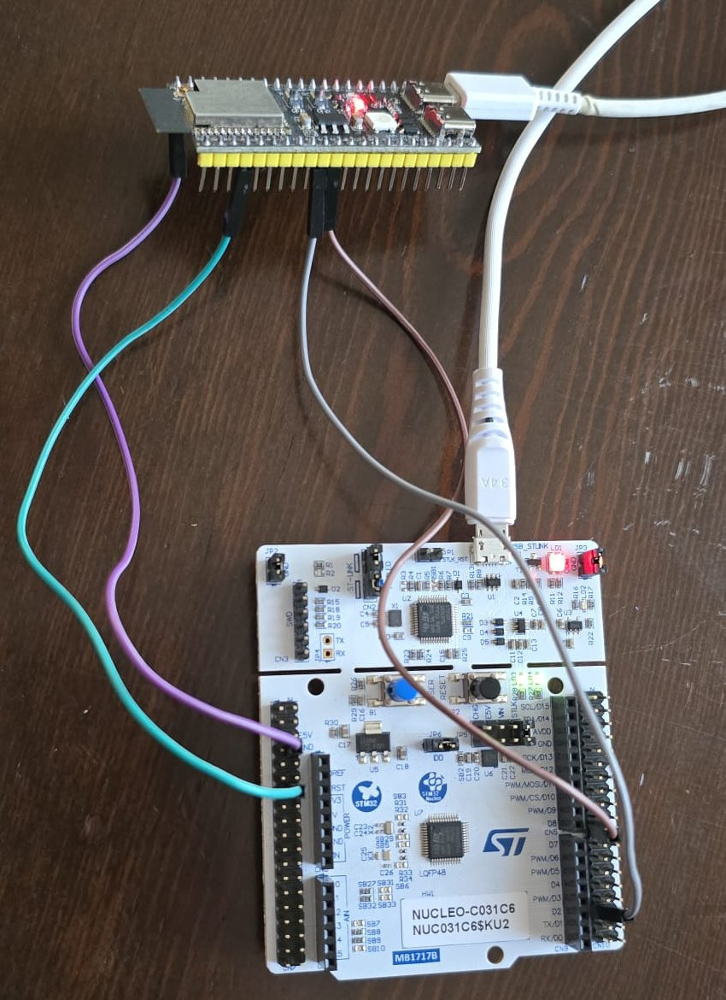
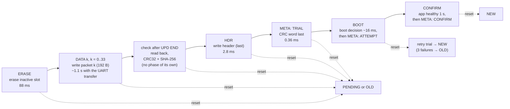
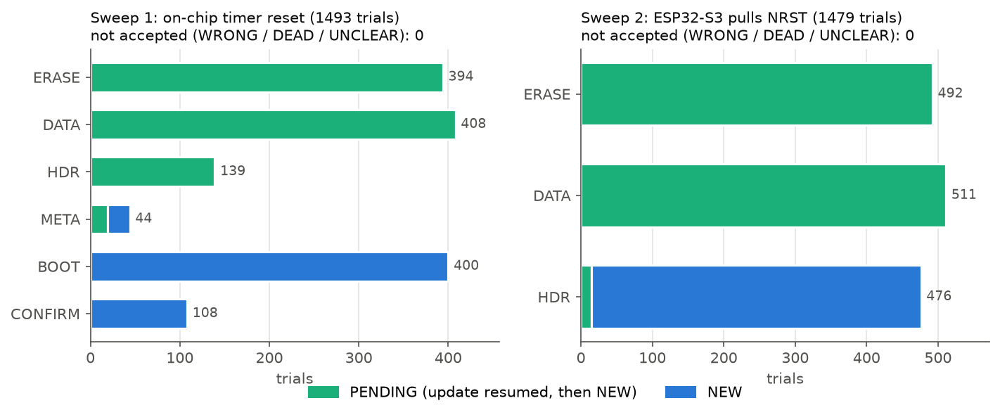
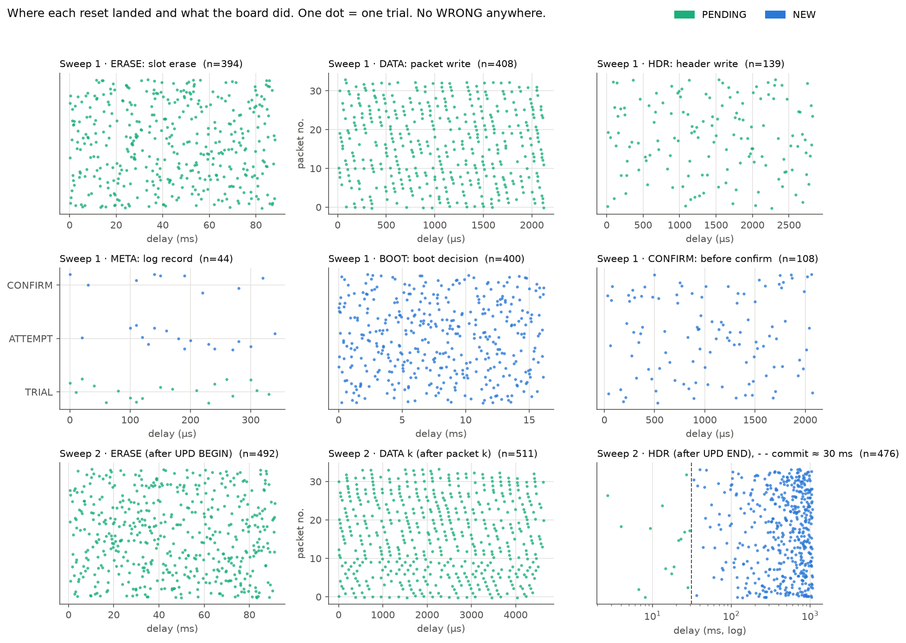
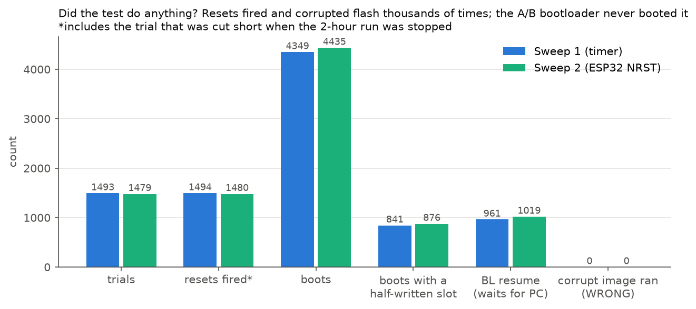
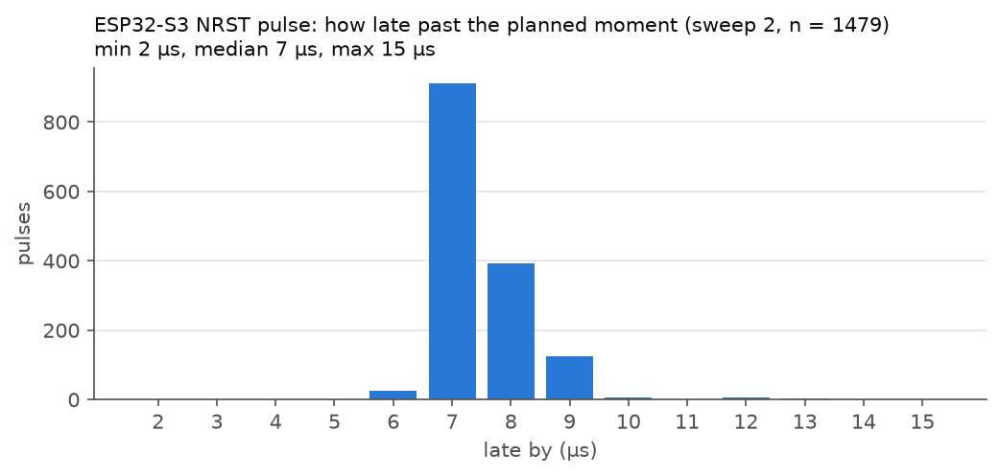
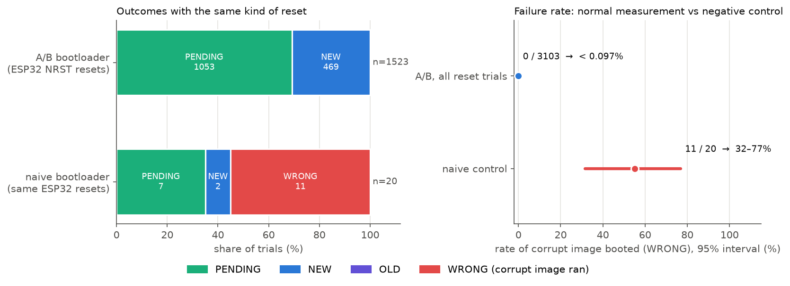
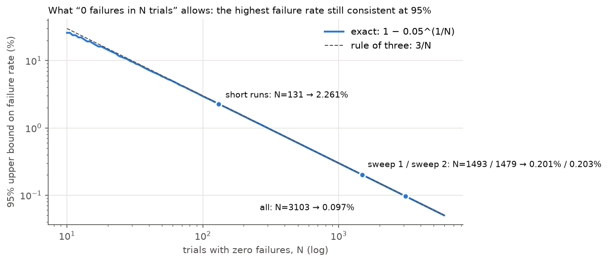

# c031-ab-bootloader-stress

**If a microcontroller is reset at any moment of a firmware update, does it still boot a correct image?**

This repo answers that question for one A/B bootloader on an STM32C031C6 (NUCLEO-C031C6). The board was
reset at 3103 planned moments during real firmware updates, from inside the chip (a timer) and from
outside (an ESP32-S3 pulling the NRST pin with microsecond timing). After every trial the host read the
flash back over SWD and decided from the flash contents what had happened.

| | Result |
|---|---|
| A/B bootloader, reset-injected updates | **0 failures in 3103 trials** (95% upper bound per trial under this sweep: **0.097%**, see [Statistics](#statistics)) |
| Naive bootloader (negative control), same ESP32 resets | **11 of 20** trials booted a corrupt image, and the tool flagged every one |
| Wall-clock time | two unattended 2-hour sweeps plus 131 shorter trials, about 4.5–4.8 s per trial |

The naive bootloader row is what makes the first row worth anything: see
[Normal measurement vs negative control](#normal-measurement-vs-negative-control).

<p align="center">
  
</p>
<p align="center"><em>The bench: the ESP32-S3 bridge (top) and the NUCLEO-C031C6. Grey and brown wires are
the UART, turquoise is NRST, purple is GND.</em></p>

**Contents:** [How the A/B bootloader works](#how-the-ab-bootloader-works) ·
[Why a sweep](#why-a-sweep-and-not-random-resets) ·
[Results](#results) ·
[Normal vs negative control](#normal-measurement-vs-negative-control) ·
[Statistics](#statistics) ·
[Next steps](#next-steps) ·
[Try it without hardware](#try-it-without-hardware) ·
[With hardware](#running-it-on-the-hardware) ·
[Repo layout](#repo-layout)

This project was split out of [aarmert/tezgah-lab](https://github.com/aarmert/tezgah-lab), a
hardware-in-the-loop test bench for STM32 boards.

## How the A/B bootloader works

The 32 KB of flash holds the bootloader, two image slots (A and B) and an append-only meta log. The
meta log is a list of 32-byte records. The newest record with a valid CRC holds the state: which slot
is active, whether the other slot is on trial, and how many trial boots it has had.

- A new image is always written to the **inactive** slot. The running image is never touched.
- The marks that make the new image valid (the header CRC and the CRC word of the meta record) are
  **always written last**. Work that a reset cuts short has no mark, and the bootloader ignores it.
- The new image boots as a **trial**. After 1 s of healthy running the app writes a CONFIRM record. An
  app that has not confirmed within 5 s stops feeding the watchdog, which resets it about 2 s later.
  After three failed attempts the bootloader rolls back to the old slot.
- Every image is checked with CRC32 on every boot. After the transfer, the bootloader also checks the
  whole image with CRC32 and SHA-256 before it writes the header.

The claim under test: whatever moment the reset lands on, the board comes up running either the old
image or the new one. It never runs a half-written image and never ends up with nothing to boot.



*Expected outcome of a reset in each phase. Timings were measured on this board.*

The names in the boxes are the **phases** used in the results table and the figures below. Each one
is a point in the firmware where the planned reset delay starts counting ([SPEC §6.2](docs/spec/SPEC.md)):

| Phase | Where the delay starts | Measured length | In the figures |
|---|---|---|---|
| ERASE | the erase of the inactive slot (4 pages) begins | 88.1 ms | |
| DATA k | the flash write of packet k begins | 2.12 ms each, 34 packets | k is the y axis of the DATA panels |
| HDR | the header write begins | 2.83 ms | |
| META | a record is appended to the meta log | 0.36 ms | the y axis of the META panel is the record: **TRIAL** (end of the update; its CRC word is the commit), **ATTEMPT** (the bootloader, just before a trial boot), **CONFIRM** (the app, after 1 s) |
| BOOT | the bootloader starts, before its boot decision | ~16 ms | |
| CONFIRM | in the app, just before it writes CONFIRM | ~2.1 ms | |

The firmware has two more phases that the sweeps barely touch: ROTATE (a meta page is erased when the
log is full) and JUMP (right before the jump to the app).

The ESP32 in sweep 2 can only fire after a line it sees on the UART, so its points are counted from
`UPD BEGIN` (ERASE), from packet k (DATA k) and from `UPD END` (HDR). Its "HDR" window therefore covers
the check, the header, the TRIAL record and the trial boot: that is why its panel switches from
PENDING to NEW at about 30 ms, when the TRIAL record is complete. The meta log is described in full in
[SPEC §4.1–4.3](docs/spec/SPEC.md).

### One trial

1. **Baseline:** the ST-LINK reads the flash. A confirmed v1 or v2 must be running.
2. **Arm the reset:** sweep 1 tells the chip's own timer (`FAULT ARM`), sweep 2 tells the ESP32
   (`NRST ARM`), "reset at this moment of this phase".
3. **Update:** the PC starts a v1→v2 (or v2→v1) update through the ESP32. The reset lands as planned.
4. **Observe:** the board reboots. If the bootloader says the update was cut short (`BL resume`), the PC
   sends the update again.
5. **Verify:** the ST-LINK reads both slots again, and their SHA-256 hashes are compared with the known
   v1/v2 images.
6. **Classify:** `stress/classify.py` gives the outcome and writes one row to `trials.csv`.

| Outcome | Meaning | Accepted |
|---|---|---|
| `NEW` | The new image runs from an intact slot | yes |
| `PENDING` | The reset cut the update short; the bootloader kept the old image and waited, the PC finished the update, and the result was `NEW` | yes |
| `OLD` | The old image runs from an intact slot | yes |
| `WRONG` | A half-written or corrupt image was started. **This is the failure we are looking for.** | no |
| `DEAD` | Nothing boots; the ST-LINK had to recover the board | no |
| `UNCLEAR` | An unexplained reset or a setup error | no |

The runs in `results/` were written before the tool's output was translated, so their files use the
Turkish names: `YENİ` = NEW, `ESKİ` = OLD, `BEKLİYOR` = PENDING, `ÖLÜ` = DEAD, `YANLIŞ` = WRONG,
`BELİRSİZ` = UNCLEAR. `python -m stress report` and `scripts/make_figures.py` map them.

## Why a sweep and not random resets

The dangerous moments are very short. The whole update takes about 1.4 s, but the TRIAL record that
says "boot the new image next" takes 0.36 ms to write. A reset at a random moment hits it with
probability

```
0.36 ms / 1400 ms ≈ 0.00026
expected hits in 3000 random trials: 3000 × 0.00026 ≈ 0.77
chance of never hitting it:           e^(−0.77) ≈ 46%
```

So 3000 random resets would have about even odds of never touching the most critical moment. Instead,
the length of every phase was first measured on the board (`calibrate`), then each phase was divided
into evenly spaced points from 0 to its length, and every point became a trial. This is what
"sweep" means here: the reset is walked through each phase step by step instead of being thrown at
random. The step is 10 µs, and long phases were capped at 800 points (in the 88 ms erase, a step of
~110 µs). The list was then shuffled with a seed, so whenever the run is stopped, the trials done so
far are a balanced sample of all phases.

| | Sweep 1 | Sweep 2 |
|---|---|---|
| Reset source | the chip's own timer (TIM3, µs resolution) | ESP32 GPIO4 → NRST (a real pin reset) |
| Phases | 6 of 8 (+1 JUMP point in the plan) | ERASE, DATA, HDR (the ones the ESP32 can trigger on) |
| Points in the plan / seed | 3001 / 2026 | 2400 / 2027 |
| Time | 2026-11-07 15:21–17:21 | 2026-11-07 17:25–19:26 |
| Trials run | 1493 | 1479 |

Each sweep was stopped cleanly with SIGINT after two hours: the tool wrote the trials so far and the
summary and released the bench lock. The trial in progress at that moment was not counted.

### Wiring

```
PC USB ── NUCLEO-C031C6 ST-LINK/V2-1     SWD + virtual COM port (USART2 PA2/PA3, 115200)
PC USB ── ESP32-S3 UART connector        CH343, 921600

ESP32 GPIO17 ──────────────────►  PA10 (USART1 RX)
ESP32 GPIO18 ◄──────────────────  PA9  (USART1 TX)
ESP32 GPIO4 (open-drain) ──────►  NRST
GND ────────────────────────────  GND
3V3 and 5V are not connected between the boards.
```

The C031 writes every line to both UARTs. The PC compares the ESP32 copy with the ST-LINK VCP copy
(the "witness"), so a line lost or changed on one path shows up.

## Results

| Phase | Sweep 1 PENDING | Sweep 1 NEW | Sweep 2 PENDING | Sweep 2 NEW |
|---|---:|---:|---:|---:|
| ERASE | 394 | | 492 | |
| DATA | 408 | | 511 | |
| HDR | 139 | | 15 | 461 |
| META | 19 | 25 | | |
| BOOT | | 400 | | |
| CONFIRM | | 108 | | |
| **Total** | **960** | **533** | **1018** | **461** |
| WRONG / DEAD / UNCLEAR | 0 / 0 / 0 | | 0 / 0 / 0 | |

In both sweeps: 0 unaccepted outcomes, 0 ST-LINK recoveries, 0 unexpected resets. The median trial took
4.5 s in sweep 1 and 4.8 s in sweep 2. The PC finished an interrupted update in a median of 3.8 s.

Together with the 131 shorter reset-injected trials of the same day (`reset_random` ×2, two short
`reset_sweep` runs, `double_fault`), that is 20 + 20 + 24 + 57 + 10 + 1493 + 1479 = **3103 trials, 0
failures**.



### Where each reset landed



*x: when the reset landed, counted from the start of the phase. y: the packet number in the DATA
panels and the meta record in the META panel; in the other panels y has no meaning, the dots are only
spread out so they do not overlap.*

The pattern is exactly what the design predicts:

- **Sweep 1, ERASE, DATA, HDR → always PENDING.** The new slot had no valid mark yet. The bootloader kept the old
  image, said the update was cut short, and the PC sent it again.
- **META: TRIAL → PENDING; ATTEMPT and CONFIRM → NEW.** A reset before the TRIAL record's CRC word left
  the previous record as the newest one. During ATTEMPT and CONFIRM the new image was already on trial;
  the bootloader tried it again and it confirmed.
- **BOOT, CONFIRM → always NEW.** The update was complete; the reset only repeated the trial boot.
- **Sweep 2, HDR: PENDING for the first ~30 ms after `UPD END`, NEW after that.** In that time the board
  checks the image with CRC32 + SHA-256 and writes the header and the TRIAL record. The commit happens
  between the last PENDING at 29.3 ms and the first NEW at 33.3 ms.

### Did the test do anything?

"No failures" is easy to get from a test that does nothing. Four checks from the same data:



| Check | Sweep 1 | Sweep 2 |
|---|---|---|
| The reset really fired | every trial (`BL fault_fired 1`) | every trial (`ESP NRST FIRED`) |
| Flash really was half-written | in 841 of 4349 boots one slot was `bad` | in 876 of 4435 boots |
| The bootloader saw the cut-short update | 961 × `BL resume` | 1019 × `BL resume` |
| The meta log wrapped around | meta page erases 0 → 36 | 36 → 74 |

Corrupt flash appeared over 1700 times. The A/B bootloader booted none of it.

### How accurate are the ESP32 pulses?



The pulses land 2 to 15 µs (median 7 µs) after the planned moment, always late. That is the same size
as the 10 µs sweep step.

Two details from the logs: in 9 sweep-1 trials the two UART copies of a line differed, all in the BOOT
phase at ~15.5–16.1 ms, where the reset cut the bootloader's banner in the middle of a character (all
`NEW`, accepted). In sweep 2, 161 trials needed 319 line retransmissions: the pulse sometimes landed
while the PC was sending the next DATA line, and the freshly booted bootloader answered the line's tail
with `ERR LINE`. The line protocol (per-line CRC, stop-and-wait, replayable packets) is built for this.
Flash wear after the day: slot pages erased 2670 (A) and 2705 (B) times; the C031 is rated for at least
10 000.

## Normal measurement vs negative control

A test that reports "0 failures" proves something only if it is able to report a failure. Two runs
answer two different questions:

| | Normal measurement | Negative control |
|---|---|---|
| Bootloader | the A/B bootloader under test | a **deliberately unsafe** naive bootloader that overwrites its only slot in place |
| Resets | 3103, timer and ESP32 NRST | 20, the **same** ESP32 NRST resets in the same phases |
| Same host tool, flash read-back and classifier | yes | yes |
| Expected result | no WRONG / DEAD | WRONG must appear |
| Result | **0 / 3103** | **11 / 20 WRONG** |
| What it shows | the bootloader survives these resets | the measurement can see a corrupt boot |



If the negative control had also come back clean, the 0/3103 would mean nothing: the classifier could
be blind (for example, comparing the wrong flash region, or calling every booting board `NEW`), and the
"good" result would come from the measurement and not from the bootloader. Because the naive
bootloader, hit by the same resets, booted a half-written image in 11 of 20 trials and the tool caught
every one by reading the slot back (`slot A holds 'other' (neither v1 nor v2)`), we know the pipeline
detects exactly the failure the A/B design is supposed to prevent.

In the naive run, the 8 ERASE resets that left the header in place and the DATA/HDR resets that left
a partial image produced `WRONG`. The 7 ERASE resets that had already wiped the header left the
bootloader with no image (`nofw`); it waited, and the resumed update finished (`PENDING`). The 2
`NEW` were late HDR resets (15.7 and 26.7 ms after `UPD END`), when the new image was already intact.

The simulator has the same pair: `reset_sweep --sim` passes 288/288 on the A/B model and
`naive_control --sim` finds 47/60 unsafe outcomes on the naive model.

## Statistics

With a true failure rate *p*, the chance of seeing 0 failures in *N* trials is (1 − *p*)^*N*. The largest
*p* still consistent with "0 failures" at 95% confidence is

```
(1 − p)^N = 0.05   →   p = 1 − 0.05^(1/N)   ≈   3 / N      (rule of three)
N = 3103           →   p < 0.000965   (3/N = 0.000967)  →  below 0.097%
```



| Set | N | 95% upper bound |
|---|---:|---:|
| Short reset runs | 131 | 2.26% |
| Sweep 1 (timer) | 1493 | 0.20% |
| Sweep 2 (ESP32 NRST) | 1479 | 0.20% |
| **All reset-injected A/B trials** | **3103** | **0.097%** |

Against the control: 11 WRONG in 20 gives a naive failure rate of 31.5%–76.9% (Clopper-Pearson, 95%),
so at least ~31%.

**How to read the 0.097%.** It is a rate *per trial under this sweep distribution*, not a field failure
rate, which also depends on how often power is lost and when. The points were chosen systematically,
not at random: the critical moments were hit far more often than random resets would hit them. That
makes the test harder, but it means the number should not be read as a random-sample estimate. What
is random is the order: the plan was shuffled, so the trials that ran are a random subset of the
planned points, and the bound holds for a reset at a randomly chosen planned point.

## Next steps

The next experiment is a power-cut sweep: the same planned moments, but the ESP32-S3 cuts the board's
supply through a MOSFET instead of pulling NRST, so the RAM "update in progress" flag is lost and the
bootloader has to recover from flash alone. After that come a mutation test (break the A/B bootloader
on purpose, for example by writing the header before the data, and check that the sweep reports
`WRONG`), runs on more boards and on the release build without the fault-injection hooks, and an
update client on the device so a `PENDING` update can finish without the PC.

## Try it without hardware

You need [uv](https://docs.astral.sh/uv/). It installs Python and the packages on the first `uv run`.

```bash
git clone https://github.com/aarmert/c031-ab-bootloader-stress.git && cd c031-ab-bootloader-stress

# The simulator models the bootloader, the flash and the reset behaviour of the C031
uv run python -m stress --json plan reset_sweep --seed 1 --sim --target c031    # the 288 faults it would inject
uv run python -m stress --json run reset_sweep --seed 1 --sim --target c031     # 288/288 pass (167 PENDING, 121 NEW)
uv run python -m stress --json run naive_control --seed 1 --sim --target c031   # the control: 47/60 unsafe (WRONG)

# Redraw the figures in docs/img from the published data in results/
uv run scripts/make_figures.py
```

The two `run` commands end like this (trimmed):

```json
{"ok": true, "summary": "reset_sweep: PASS. 288/288 trials met the pass criterion", "counts": {"PENDING": 167, "NEW": 121}}
{"ok": true, "summary": "naive_control: PASS. naive control showed 47/60 unsafe outcomes (DEAD/WRONG): the test can see failures", "counts": {"WRONG": 47, "PENDING": 7, "NEW": 6}}
```

Note that `naive_control` passes when the naive bootloader *fails*: its pass criterion is that unsafe
outcomes appear. Each run writes a folder under `stress_runs/`.

Unit tests (the firmware tests build the images, so they need `arm-none-eabi-gcc`):

```bash
uv run python -m unittest discover -s stress/tests          # 140 tests
uv run python -m unittest discover -s firmware/boot_c0/tests
uv run python -m unittest discover -s firmware/boot/tests
```

Without `--target c031` the simulator models the F407 port in `firmware/boot/` (255 trials in
`reset_sweep`). The F407 port has only run in the simulator. The C031 build also needs it: the
`bad_image` test uses a real F407 app as its "wrong board" image.

## Running it on the hardware

| For | You need |
|---|---|
| Host tool | [uv](https://docs.astral.sh/uv/) (installs Python and `pyserial`) |
| Firmware | `arm-none-eabi-gcc` |
| Flashing and flash read-back | OpenOCD newer than 0.12.0 (0.12.0 has no `stm32c0x.cfg`; a git build works) |
| ESP32 bridge | `arduino-cli` with the esp32 core; upload it yourself |

```bash
cp stress.example.toml stress.toml                 # then fill in the ports
cp bench-c031.example.toml bench-c031.toml
uv run firmware/boot_c0/build_boot.py --json      # bootloaders, apps, images
uv run esp32/build.py --json                      # compile the bridge, then upload it yourself

uv run python -m stress --json doctor --target c031
uv run python -m stress --json calibrate --target c031
uv run python -m stress --json run basic --target c031 --n 20

# Sweep 1 (on-chip timer); stop it with Ctrl+C whenever you like
uv run python -m stress --json run reset_sweep --target c031 --seed 2026 --max-points-per-phase 800
# Sweep 2 (ESP32 NRST)
uv run python -m stress --json run reset_sweep --target c031 --seed 2027 --reset-source esp --max-points-per-phase 800
# The control
uv run python -m stress --json run naive_control --target c031 --n 20 --reset-source esp

uv run python -m stress --json report stress_runs/<run-folder> --plot
```

The tests are `basic`, `transfer_cut`, `line_noise`, `reset_random`, `reset_sweep`, `double_fault`,
`bad_image`, `rollback` and `naive_control`. [`stress/README.md`](stress/README.md) describes each one,
how a trial runs and how outcomes are classified. `bench.py` is the flashing/serial layer the stress
tool imports. It is a copy of `bench.py` from [f407-hil-bench](https://github.com/aarmert/f407-hil-bench),
where it is maintained and also drives the F407 functional test bench; it is included here so this repo
runs on its own.

## Repo layout

| Path | What |
|---|---|
| `stress/` | the host tool: planner, runner, classifier, simulator, report (`python -m stress`) |
| `bench.py` | flashing, SWD read-back and serial layer used by `stress/` (a copy from f407-hil-bench, unchanged) |
| `firmware/boot_c0/` | A/B and naive bootloaders, test apps and image builder for the C031 |
| `firmware/boot/` | the F407 port of the same (simulator only; also supplies the wrong-board image) |
| `firmware/wiretest_c031/` | a small wiring check for the C031 bench, not part of the stress system |
| `esp32/` | the ESP32-S3 line bridge with the timed NRST pulse |
| `AGENTS.md`, `CLAUDE.md` | rules for a coding agent driving this bench (touch the board only through `python -m stress`) |
| `docs/spec/` | the specs: `SPEC.md`, `SPEC-C031C6.md`, `SPEC-ESP32.md` |
| `docs/img/` | the bench photo and the figures |
| `results/` | the hardware runs of 2026-11-07: `trials.csv`, `summary.md`, `summary.json`, `run.json`, `serial.log` |
| `scripts/make_figures.py` | draws `docs/img/*.png` from `results/` |

### `results/`

| Folder | Result |
|---|---|
| `reset_sweep_20261107-152056` | sweep 1: 1493/1493 (timer hook, seed 2026) |
| `reset_sweep_20261107-172507` | sweep 2: 1479/1479 (ESP32 NRST, seed 2027) |
| `naive_control_20261107-121450` | the control: 11/20 WRONG |
| `reset_random_20261107-121105`, `reset_random_20261107-121251` | 20/20 each (hook, ESP) |
| `reset_sweep_20261107-122336`, `reset_sweep_20261107-122531` | 24/24 (ESP, 3 phases), 57/57 (hook, 8 phases, `--meta-near-full`) |
| `double_fault_20261107-122248` | 10/10 (two resets per trial) |
| `basic_…`, `transfer_cut_…`, `line_noise_…`, `bad_image_…`, `rollback_…` | 4/4 NEW, 10/10 OLD, 10/10 NEW, 2/2, 2/2 OLD (no reset injection) |
| `calibrate_*`, `calibration_c031.json` | the phase lengths and ESP32 windows the sweeps used |
| `wear.json` | flash erase counters |

The host name, home directory, ST-Link serial number and board UIDs were replaced with placeholders
(`<host>`, `~/`, `<stlink-serial>`, `<board-uid-N>`). Nothing else was changed.

## License

Apache-2.0, see [LICENSE](LICENSE).
