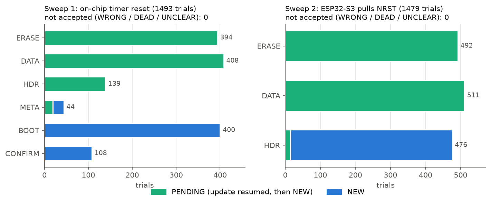
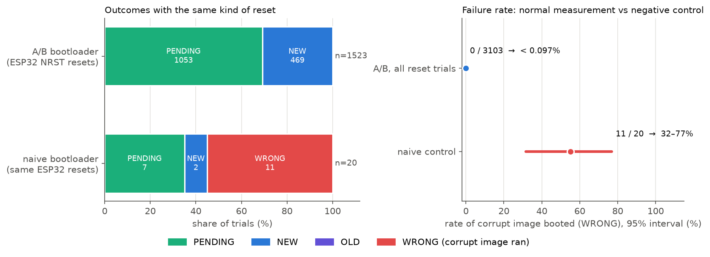
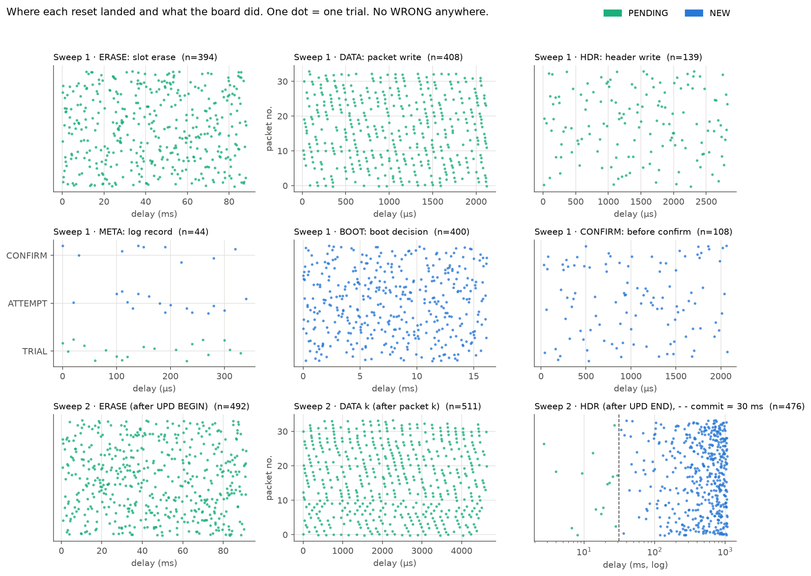

# c031-ab-bootloader-stress (Türkçe özet)

**Bir mikrodenetleyici firmware güncellemesinin herhangi bir anında resetlenirse yine doğru bir imajla açılır mı?**

Bu depo bu soruyu NUCLEO-C031C6 (STM32C031C6) üzerindeki bir A/B bootloader için yanıtlıyor. Kart, gerçek
güncellemeler sırasında önceden planlanmış 3103 anda resetlendi: çipin kendi zamanlayıcısıyla (1. tur) ve
dışarıdan, bir ESP32-S3'ün NRST pinini mikrosaniye hassasiyetle çekmesiyle (2. tur). Her denemeden sonra
flash SWD ile geri okundu ve sonuç kartın söylediğine değil flash içeriğine göre sınıflandırıldı.

| | Sonuç |
|---|---|
| A/B bootloader, reset atılan güncellemeler | **3103 denemede 0 bozulma** (hata oranı %95 güvenle **%0,097'nin altında**) |
| Naif bootloader (negatif kontrol), aynı ESP32 resetleri | **20 denemenin 11'inde** bozuk imaj çalıştı, araç hepsini yakaladı |
| Süre | iki adet insansız 2 saatlik tarama + 131 kısa deneme, deneme başına ~4,5-4,8 s |

Ayrıntılı İngilizce açıklama ve tüm grafikler [README.md](README.md) içinde. Tam Türkçe rapor:
[`docs/pdf/tezgah-3000-deneme-raporu.pdf`](docs/pdf/tezgah-3000-deneme-raporu.pdf). Bu proje
[aarmert/tezgah-lab](https://github.com/aarmert/tezgah-lab) deposundan ayrıldı.



## Normal ölçüm ve negatif kontrol farkı

"0 hata" sonucu, ancak test hatayı görebiliyorsa bir şey kanıtlar.

| | Normal ölçüm | Negatif kontrol |
|---|---|---|
| Bootloader | test edilen A/B bootloader | **bilerek güvensiz yazılmış**, tek slotunun üstüne yazan naif bootloader |
| Resetler | 3103 (zamanlayıcı + ESP32 NRST) | 20, **aynı** ESP32 NRST resetleri |
| Araç, flash okuma ve sınıflandırıcı | aynı | aynı |
| Beklenen | YANLIŞ / ÖLÜ yok | YANLIŞ görülmeli |
| Sonuç | **0 / 3103** | **11 / 20 YANLIŞ** |
| Gösterdiği | bootloader bu resetlere dayanıyor | ölçüm bozuk açılışı görebiliyor |



Negatif kontrol de temiz çıksaydı 0/3103 bir şey ifade etmezdi: sınıflandırıcı kör olabilirdi (yanlış
flash bölgesini karşılaştırmak, açılan her kartı YENİ saymak gibi). Naif bootloader aynı resetlerle 20'de
11 kez yarım imaj çalıştırdı ve araç her birini slotu geri okuyarak yakaladı. Yani ölçüm, A/B tasarımının
önlemesi gereken hatayı tam olarak görebiliyor.

## Neden rastgele değil "tarama"?

Güncelleme ~1,4 s sürüyor ama TRIAL kaydı yalnızca 0,36 ms. Rastgele 3000 resetle bu ana hiç denk gelmeme
ihtimali ≈ %46. Bu yüzden her fazın süresi ölçüldü, her faz eşit aralıklı noktalara bölündü (kısa fazlarda
10 µs adım, uzunlarda faz başına en fazla 800 nokta) ve her nokta bir deneme oldu.



## İstatistik

N denemede hiç hata yoksa %95 üst sınır `p = 1 − 0,05^(1/N) ≈ 3/N` (üçler kuralı). N = 3103 için
p < %0,097. Naif bootloader'ın hata oranı 11/20'den %95 güvenle %31,5-%76,9 (Clopper-Pearson). A/B de %31
hatalı olsaydı 3103 denemede hiç hata görmeme ihtimali 0,69^3103 ≈ 10^-500 olurdu.

Bu oran "bu tarama dağılımında deneme başına" bir oran, sahadaki arıza oranı değil.

## Bu test neyi (henüz) göstermiyor?

Başka kartları (tek kart), satış sürümünü (hook'lu test sürümü kullanıldı), PC'siz kurtarmayı ve güvenliği
(dijital imza yok).

## Sıradaki deney: gerçek elektrik kesintisi

Resette RAM korunur, "güncelleme sürüyor" bayrağı resetten sağ çıkar. Elektrik kesilince bu bilgi kaybolur
ve besleme düşerken flash farklı davranabilir. Sıradaki deney aynı tarama, ama reset yerine ESP32-S3'ün bir
MOSFET ile kartın beslemesini aynı planlı anlarda kesmesiyle. Bootloader yalnızca flash'taki bilgiyle
toparlanmak zorunda kalacak. Sonuçlar hazır olunca bu repoda yayınlanacak. Ardından mutasyon testi gelecek:
A/B bootloader bilerek bozulacak (ör. başlık veriden önce yazılacak) ve taramanın bunu `WRONG` olarak
yakaladığı gösterilecek.

## Donanımsız deneme

```bash
uv run python -m stress --json run reset_sweep --seed 1 --sim --target c031     # 288/288 geçer
uv run python -m stress --json run naive_control --seed 1 --sim --target c031   # kontrol: 47/60 güvensiz
uv run scripts/make_figures.py                                                  # grafikleri yeniden çizer
```

Donanımla çalıştırma, kablolama ve klasör yapısı için [README.md](README.md).
